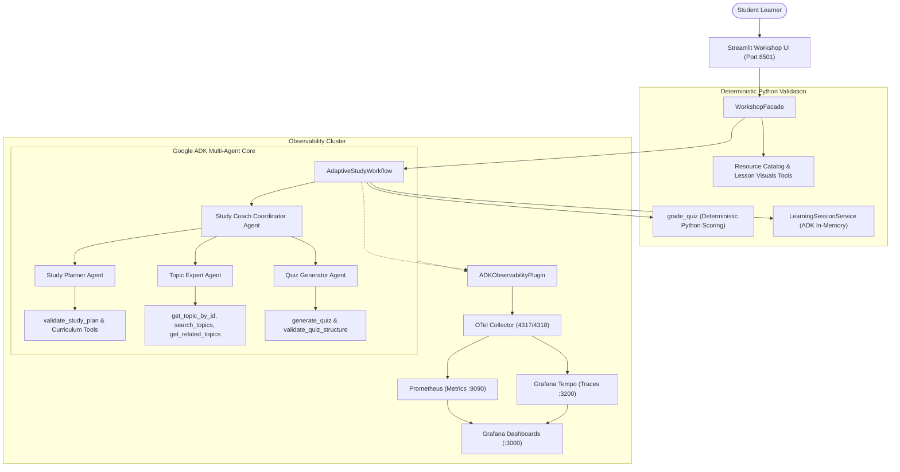

# Gemini ADK Multi-Agent Study Coach Lab

[](https://www.python.org/downloads/)
[](https://pypi.org/project/gemini-adk-study-coach-lab/)
[](https://github.com/google/adk)
[](https://ai.google.dev/)
[](https://streamlit.io/)
[](LICENSE)

An open-source, production-ready, multi-agent AI system built with **Google Agent Development Kit (ADK)**, **Gemini models**, **Pydantic v2**, and open-standards observability (**OpenTelemetry, Prometheus, Grafana, Tempo**). Designed for technical certification preparation and hands-on developer workshops (e.g., GDG / DevFest).

---

## 1. Project Overview

The **Gemini ADK Multi-Agent Study Coach** guides students preparing for technical certifications—such as the **Google Cloud Generative AI Leader** certification—through an end-to-end adaptive study journey:

1. **Personalized Planning**: Generates customized day-by-day study schedules strictly respecting student time availability ($\le N$ min/day) and exam deadlines.
2. **Concept Explanations**: Teaches syllabus topics tailored to student experience levels (*beginner*, *intermediate*, *advanced*) with practical Google Cloud architecture scenarios.
3. **Formative Assessment**: Delivers interactive 3-question Quick Knowledge Checks with instant deterministic scoring and feedback.
4. **Practice Quizzing**: Generates 5-question multiple-choice practice quizzes with private answer keys securely protected server-side.
5. **Adaptive Remediation**: Dynamically identifies student knowledge gaps ($< 70\%$ mastery threshold) and generates adapted plans prioritizing remediation.
6. **Agent Observability**: Provides deep visibility into agent reasoning, tool calls, and model latency via OpenTelemetry distributed tracing and Prometheus metrics.

---

## 2. Key Features

- **Multi-Agent Specialization**: Decoupled, single-responsibility agents coordinated by a root delegator.
- **Strict Deterministic Guarantees**: Time arithmetic, answer grading, and topic-existence checks run in 100% pure Python—eliminating LLM hallucination in quantitative scoring.
- **Client-Side Answer Masking**: Private answer keys and explanations remain on the server until students submit answers.
- **Grounded Curriculum Taxonomy**: Explanations and quizzes are strictly anchored to a structured YAML certification curriculum.
- **Curated Resource Library**: Topic-specific documentation, guides, and tutorials featuring vector brand SVG logos across 19 technical providers.
- **Privacy-Safe Sharing**: Pre-populated LinkedIn post generator and share popovers (Copy Link, Email, X/Twitter) that never auto-post without user consent.
- **Production Observability**: OpenTelemetry tracing of ADK agent and tool lifecycles, Prometheus metric scrapers, and an 11-panel Grafana dashboard.
- **Interactive Evaluations GUI**: Dedicated Streamlit dashboard for running and inspecting multi-agent evaluation scenarios.
- **Containerized & Local-First**: Runs natively with Python/`uv` or containerized with Docker Compose.

---

## 3. Multi-Agent Architecture

The Study Coach architecture couples Google ADK agent delegation with deterministic Python validation:



For full architectural specifications and sequence flows, see [Architecture Documentation](docs/architecture.md).

---

## 4. Agent Responsibilities

| Agent | Responsibility | Core Tools | Output Contract |
| :--- | :--- | :--- | :--- |
| **Study Coach** (`study_coach`) | Root coordinator routing student requests to specialist agents | `invoke_agent` | Conversation routing & delegation |
| **Study Planner** (`study_planner`) | Builds sequential study schedules adhering to daily time budgets | `validate_study_plan`, `load_curriculum` | Validated `StudyPlan` model |
| **Topic Expert** (`topic_expert`) | Explains certification topics with GCP practical scenarios | `get_topic_by_id`, `search_topics`, `get_related_topics` | Structured `TopicExplanation` model |
| **Quiz Generator** (`quiz_generator`) | Generates 4-choice multiple-choice questions anchored in curriculum | `generate_quiz`, `validate_quiz_structure` | `Quiz` (with server-only answer keys) |

---

## 5. Certification Curriculum

The application is grounded in the **Google Cloud Generative AI Leader** curriculum (`src/study_coach/data/curriculum.yaml`):

1. **`genai_concepts`**: Generative AI Concepts, Discriminative vs Generative AI, Modalities.
2. **`llm_architecture`**: Large Language Model Fundamentals, Transformer Architecture, Attention Mechanisms.
3. **`prompt_engineering`**: Prompt Engineering Strategies, Few-Shot Prompting, Parameter Controls (Temperature, Top-P/Top-K).
4. **`grounding_rag`**: Grounding, Retrieval-Augmented Generation (RAG), Vertex AI Search & Vector Search.
5. **`responsible_ai`**: Responsible AI Principles, Safety Filters, Fairness, Bias, and Governance on Google Cloud.

---

## 6. End-to-End Learning Experience

### A. Study Plan
Students configure exam deadlines (e.g. 14 days) and daily availability (e.g. 90 minutes). The Study Planner produces a balanced day-by-day plan guaranteed never to exceed daily limits.

### B. Learn Topic
Students explore curriculum topics with 6 structured views:
- **Summary & Objectives**: Clear learning goals and foundational vocabulary.
- **Architecture Diagram**: Interactive Mermaid technical diagram with text alternative.
- **Step-by-Step Lesson**: Deep conceptual explanation with real-world Google Cloud enterprise scenarios.
- **Hands-On Python**: Self-contained, runnable Python code examples with expected outputs.
- **Verified Resources**: Official Google documentation, guides, and video tutorials.
- **Practice & Share**: Formative Quick Knowledge Check and LinkedIn post generator.

### C. Formative Quick Checks
Three targeted multiple-choice questions delivered to the student view. Correct answers are hidden until submission, where deterministic Python scoring provides immediate score feedback (100%, 66.7%, 33.3%, 0%) and explanatory review.

### D. Practice Quiz
Five formal exam-style questions. Correct answers and detailed explanations remain in server-side session memory. After submission, answers are scored deterministically against the ground truth.

### E. Adaptive Replanning
If a student scores below 70% on any curriculum topic, the system flags it as a **Weak Topic**. The student can request an **Adapted Study Plan** (Revision 2), which preserves completed study days and dynamically reallocates remaining time to prioritize remediation.

---

## 7. Curated Learning Resources & Brand Icons

The resource catalog (`src/study_coach/data/learning_resources.yaml`) features curated, verified external documentation and tutorials. Each card renders an authentic ~28px vector SVG provider logo mapped via URL hostname classification across 19 technical platforms:
- **Cloud & AI**: Google Cloud, Google Developers, Hugging Face, Anthropic, OpenAI, DeepLearning.AI.
- **Code & Community**: GitHub, GitLab, Stack Overflow, Reddit.
- **Education & Media**: YouTube, Coursera, Medium, Wikipedia, Substack, ArXiv, Real Python.
- **Social & Professional**: LinkedIn.

---

## 8. Agent Ops & Observability

Study Coach includes deep telemetry using standard open-source tools:

- **OpenTelemetry Collector**: Receives traces and metrics over OTLP gRPC (`4317`) and HTTP (`4318`).
- **Grafana Tempo**: Distributed trace storage indexing agent reasoning, tool execution, and LLM inference spans.
- **Prometheus**: Scrapes application metrics from port `8000/metrics` and Collector metrics from `8889`.
- **Grafana**: Pre-provisioned 11-panel dashboard (`study-coach-main`) tracking request volume, agent latencies, quiz submission distributions, and adaptive replans.
- **🔭 Agent Ops GUI**: In-app Streamlit tab providing real-time target health indicators, container readiness, and one-click links to Grafana and Tempo Explore.

For detailed configuration, see [Observability Guide](docs/observability.md).

---

## 9. Multi-Agent Evaluations GUI

Study Coach features an interactive **🧪 Evaluations** tab in Streamlit powered by `EvaluationRunner`:
- **User-Triggered Execution**: Non-blocking evaluation run initiated explicitly via button.
- **Scenario Audit**: Tests Study Planner constraints, Topic Expert grounding, Quiz Generator schema validity, and Coordinator routing.
- **Metrics Tracking**: Measures scenario pass/fail status, model name (`gemini-3.8-flash`), execution latency, and error traces.
- **Sanitized Persistence**: Saves evaluation summaries to `docs/reports/recent_evaluation_report.json`.

For evaluation methodology, see [Evaluation Guide](docs/evaluation.md).

---

## 10. Application Screenshots & Observability

### A. Personalized 14-Day Study Plan


*The Study Planner creates a daily learning schedule with a defined time budget and curriculum-aligned activities.*

### B. Interactive Topic Learning & Quick Checks


*The Learn Topic experience includes explanations, verified resources, architecture diagrams, and a 3-question formative MCQ flow.*

### C. Grafana Observability Dashboard


*Visualizes workflow requests, agent calls, quiz submissions, adaptive replanning, agent/tool activity, and latency.*

### D. Prometheus Healthy Scrape Targets


*Both the Study Coach application and OpenTelemetry Collector appear as UP in Prometheus.*

### E. Distributed Trace Waterfall in Grafana Tempo


*Visualizes 24 hierarchical spans captured during a live `explain_topic` workflow in Grafana Tempo, showing:*
- **Workflow Root**: `study_coach.explain_topic` (36.11s)
- **Agent Lifecycle**: `invocation`, `adk.agent.topic_expert`, and `invoke_agent topic_expert` (36.06s)
- **Gemini Model Calls**: `call_llm` and underlying `generate_content gemini-3.8-flash` spans measuring inference latency
- **Tool Executions**: `get_topic_by_id`, `get_related_topics`, `search_topics`, and `set_model_response`

---

## 11. Quick Start with `gemini-adk-study-coach-lab` CLI

Run Gemini ADK Study Coach directly without cloning the repository!

📦 **Official PyPI Package**: [https://pypi.org/project/gemini-adk-study-coach-lab/](https://pypi.org/project/gemini-adk-study-coach-lab/) (Version: `1.1.0`)

### Zero-Clone Execution via `uvx` (Recommended)
Run the application instantly without cloning or local installation:
```bash
# Set your Gemini API key
export GEMINI_API_KEY="your-api-key"

# Instant zero-clone execution via uvx
uvx gemini-adk-study-coach-lab
```

### Installation via `pipx`
For persistent global installation on your machine:
```bash
pipx install gemini-adk-study-coach-lab
gemini-adk-study-coach-lab
```

### Pre-Publication Validation (Local Wheel)
To build and run from local source distribution:
```bash
# Build the distribution packages
uv build

# Install and run the wheel in an isolated tool environment
uv tool install dist/gemini_adk_study_coach_lab-1.1.0-py3-none-any.whl

# Run the CLI
gemini-adk-study-coach-lab --help
gemini-adk-study-coach-lab doctor
gemini-adk-study-coach-lab start
```

### CLI Commands Reference

| Command | Description | Example |
| :--- | :--- | :--- |
| `gemini-adk-study-coach-lab` | Default command: starts Streamlit Study Coach UI on port 8501 | `gemini-adk-study-coach-lab` |
| `gemini-adk-study-coach-lab start` | Starts Streamlit UI with options for custom port, address, and headless mode | `gemini-adk-study-coach-lab start --port 8502 --headless` |
| `gemini-adk-study-coach-lab doctor` | Runs environment diagnostics (Python, dependencies, API keys, ports, Docker) | `gemini-adk-study-coach-lab doctor` |
| `gemini-adk-study-coach-lab version` | Displays installed package version | `gemini-adk-study-coach-lab version` |
| `gemini-adk-study-coach-lab --help` | Shows full CLI help and command options | `gemini-adk-study-coach-lab --help` |

*(Note: `gemini-adk-study-coach` is also available as a console script alias for backward compatibility).*

#### Available Flags for `start`:
- `-p, --port <PORT>`: Local port to bind Streamlit server (default: `8501`).
- `--address <ADDR>`: Network address to bind server (default: `127.0.0.1`; use `0.0.0.0` for all interfaces).
- `--headless`: Run Streamlit in headless mode without auto-opening a browser tab.

#### Environment Variables & Credentials:
- `GEMINI_API_KEY` or `GOOGLE_API_KEY`: Required for AI study plans, explanations, and quizzes.
- `GEMINI_MODEL`: Model name (default: `gemini-3.8-flash`).
- `.env` files in your active working directory are automatically detected and loaded.

#### Upgrading & Uninstalling:
```bash
# Upgrade when using pipx
pipx upgrade gemini-adk-study-coach-lab

# Uninstall
pipx uninstall gemini-adk-study-coach-lab
# or via uv tool
uv tool uninstall gemini-adk-study-coach-lab
```

---

## 12. Local Developer Setup (From Source Repository)

> **No Docker required for the core learning workshop!**

### 1. Prerequisites
- **Python 3.12+**
- **uv** package manager (`curl -LsSf https://astral.sh/uv/install.sh | sh`)
- **Git**
- **Gemini API Key** (obtainable free from [Google AI Studio](https://aistudio.google.com/))

### 2. Setup & Run
```bash
# Clone the repository
git clone https://github.com/hastimal/gemini-adk-study-coach-lab.git
cd gemini-adk-study-coach-lab

# Install dependencies using uv
uv sync

# Configure API Key
cp .env.example .env
# Edit .env and insert your GOOGLE_API_KEY

# Run the Streamlit Workshop UI
uv run streamlit run ui/app.py
```

Access the application in your browser at:  
👉 **http://localhost:8501**

### 3. Unified Developer Lab Launcher (Optional)
To launch a unified launcher dashboard with health indicators across all ports:
```bash
./scripts/run_local.sh
```
Access the launcher at: **http://localhost:8500**

---

## 12. Optional Docker Observability Stack

If Docker Desktop is installed and you want the full Grafana, Prometheus, and Tempo telemetry cluster:

```bash
# Build and launch all five services
docker compose --profile observability up -d --build

# Verify container health
docker compose --profile observability ps
```

### Endpoints
- **Streamlit Web UI**: [http://localhost:8501](http://localhost:8501)
- **Developer Lab Launcher**: [http://localhost:8500](http://localhost:8500)
- **Application Prometheus Metrics**: [http://localhost:8000/metrics](http://localhost:8000/metrics)
- **Prometheus TSDB**: [http://localhost:9090](http://localhost:9090)
- **Grafana Dashboards**: [http://localhost:3000](http://localhost:3000) (User/Pass: `admin` / `admin`)
- **Grafana Tempo Trace Explorer**: [http://localhost:3000/explore](http://localhost:3000/explore)

To safely stop containers:
```bash
docker compose --profile observability down
```

---

## 13. Workshop Guide (GDG / DevFest)

Complete documentation is available in `docs/workshop/` for organizing a 60-minute hands-on developer lab:
- **[Instructor Guide](docs/workshop/instructor-guide.md)**: 60-minute session timeline, speaking goals, and live fallbacks.
- **[Attendee Setup Guide](docs/workshop/attendee-setup.md)**: Platform-specific guides for macOS, Linux, and Windows.
- **[Demo Script](docs/workshop/demo-script.md)**: Step-by-step speaker notes and student prompt walkthrough.
- **[Hands-On Exercises](docs/workshop/exercises.md)**: Interactive attendee activities and advanced post-workshop exercises.
- **[Troubleshooting Guide](docs/workshop/troubleshooting.md)**: Rapid solutions for common setup, port, and rate-limit issues.
- **[Architecture Walkthrough](docs/workshop/architecture-walkthrough.md)**: Deep dive into agent specialization and telemetry.
- **[Workshop Hub](docs/workshop.md)**: Complete workshop documentation index.

---

## 14. Testing & Quality Assurance

Run the complete deterministic test suite and linters:

```bash
# Run linting, formatting check, and type checks
uv run ruff check .
uv run ruff format --check .
uv run mypy .

# Run all 156 unit and integration tests
uv run pytest -q
```

To run the live Gemini multi-agent evaluation scenarios:
```bash
uv run python tests/eval/run_live_evaluation.py
```

---

## 15. Security & Privacy

1. **Answer-Key Protection**: Questions delivered to the browser never include ground-truth answer keys or internal explanations.
2. **Deterministic Grading**: All quiz scoring is evaluated server-side in deterministic Python code.
3. **Telemetry Redaction**: `ADKObservabilityPlugin` automatically scrubs authorization tokens and API keys (`[REDACTED_API_KEY]`) from trace spans and metric labels.
4. **Zero Auto-Posting**: Resource sharing and LinkedIn post drafts only populate user clipboard/share dialogs; no social media account access or automatic posting is performed.
5. **No Hardcoded Secrets**: Secrets are loaded strictly from `.env` or system environment variables.

---

## 16. Current Limitations (v1.0.0)

- **Curriculum Scope**: Grounded in the Google Cloud Generative AI Leader certification syllabus. Custom track authoring is scheduled for post-v1.0.0.
- **Session Persistence**: Sessions are tracked in-memory using ADK `InMemorySessionService`; restarting the Streamlit server resets active student sessions.
- **Live Gemini Requirements**: Interactive plan generation and topic teaching require an active Gemini API key with available quota.

---

## 17. Future Feature Roadmap (Post-v1.0.0)

> Detailed technical specifications, domain models, and phasing are documented in [docs/roadmap.md](docs/roadmap.md).

- **Future Feature 1: Multi-Certification Management**:
  - SQLite persistence layer for custom certification tracks (AWS, Azure, Kubernetes, custom enterprise).
  - Curriculum editor GUI for adding and validating custom syllabus topics.
  - Certification-scoped student session isolation.
- **Future Feature 2: Document RAG + Agent Chatbot + Guide MCQs**:
  - Local-first PDF, DOCX, TXT, and Markdown ingestion and vector indexing.
  - Retrieval-grounded ADK chatbot with verifiable page and excerpt citations.
  - Document-derived practice MCQs with deterministic grading and source-page attribution.

---

## 18. Milestone History

- **Milestone 1**: Project Foundation (v0.1.0)
- **Milestone 2**: Study Planner Agent (v0.2.0)
- **Milestone 3**: Topic Expert Agent (v0.3.0)
- **Milestone 4**: Quiz Generator Agent (v0.4.0)
- **Milestone 5**: Multi-Agent Orchestration (v0.5.0)
- **Milestone 6**: Workshop UI & Containerization (v0.6.0)
- **Milestone 7**: Observability, Telemetry & Evaluations (v0.7.0)
- **Milestone 8**: Workshop-Ready Release (v1.0.0)

---

## 19. Contributing

Contributions are welcome! Please follow these guidelines:
1. Ensure all code passes `ruff check`, `ruff format --check`, and `mypy`.
2. Ensure all tests pass with `uv run pytest -q`.
3. Preserve existing deterministic Python validation contracts.
4. Open an issue or pull request describing your enhancement.

---

## 20. License

This project is licensed under the MIT License — see the [LICENSE](LICENSE) file for details.
