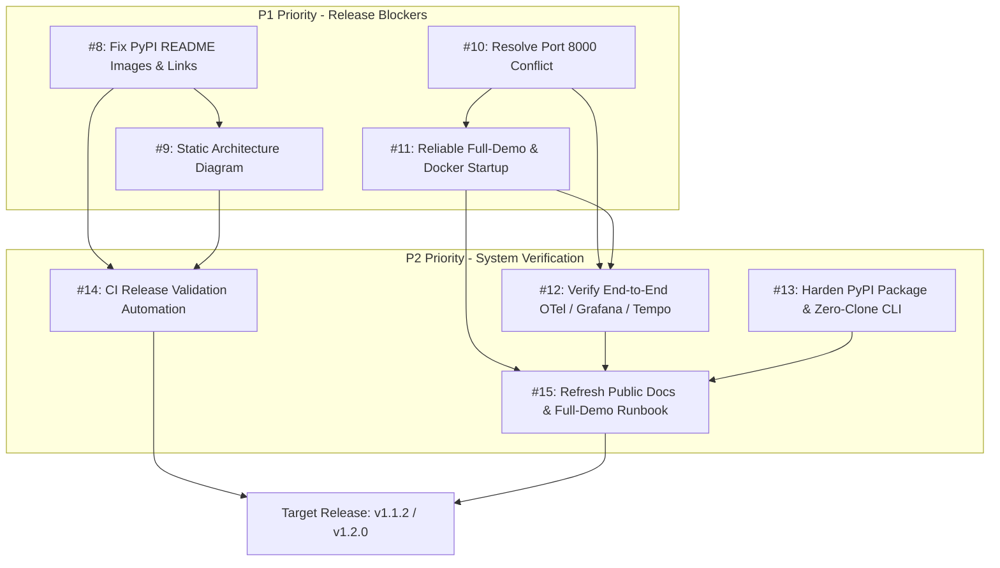

# Antigravity Milestone 11 — PyPI, Docker & Documentation Release Hardening Backlog

## Original Prompt Verbatim

```markdown
# ANTIGRAVITY — CREATE PYPI, DOCKER & DOCUMENTATION ISSUES

REPOSITORY:
hastimal/gemini-adk-study-coach-lab

GOAL:
Create a high-quality GitHub issue backlog to fix
the published PyPI page, architecture diagrams,
local launcher, Docker observability stack, and
package validation.

This is ISSUE CREATION ONLY.
Do not implement code changes in this task.

FIRST:
1. Read GEMINI.md.
2. Read README.md, README-pypi.md, pyproject.toml.
3. Inspect docs/images, scripts/run_local.sh,
   Docker Compose and observability configuration.
4. Inspect existing GitHub issues including #1–#6.
5. Do not create duplicate issues.
6. Check latest release/tag and main branch state.
7. Confirm the current PyPI long description.

ISSUES TO CREATE IF NOT ALREADY COVERED:

[P1-01] Fix PyPI README Images and Broken Links

Description:
The production PyPI page contains broken screenshots
and repository-relative documentation links.

Acceptance criteria:
- All PyPI images render correctly.
- All image URLs return HTTP 200.
- No repository-relative images in long description.
- Existing screenshots remain version controlled.
- PyPI description renders correctly.
- No broken documentation links.
- twine check passes for wheel and sdist.
- Validate with an actual rendered page.

[P1-02] Replace Mermaid Source With Professional
Static Architecture Diagram

Description:
PyPI displays raw Mermaid graph TD source instead
of the intended architecture visualization.

Acceptance criteria:
- Clear, accurate diagram of implemented agents.
- Editable SVG maintained in docs/images.
- Static PNG for PyPI compatibility.
- Labels remain readable at normal page width.
- No arrow overlaps or clipped labels.
- Main README and PyPI description render properly.
- Retain detailed Mermaid source separately.
- No invented agents, services or workflows.

[P1-03] Resolve ADK Developer UI and
Prometheus Metrics Port Conflicts

Description:
Port 8000 is associated with both ADK UI and
application metrics across local tooling/docs.

Acceptance criteria:
- Document actual port ownership.
- Assign distinct configurable ports.
- Avoid collisions with Streamlit and launcher.
- Existing metrics scrape configuration works.
- ADK UI starts successfully.
- Docker startup does not occupy unexpected ports.
- Health endpoints are tested.
- Non-conflicting defaults are documented.

[P1-04] Make Full Docker and Local Demo Startup
Reliable

Description:
The local demo launcher may show ADK and Docker
online while Streamlit remains offline.

Acceptance criteria:
- Inspect scripts/run_local.sh modes.
- Define a documented full-demo startup mode.
- Streamlit launches reliably on port 8501.
- ADK UI starts on its configured port.
- Grafana, Prometheus, Tempo, and Collector start.
- Health checks use correct endpoints.
- Startup handles already-running services.
- Clear failure diagnostics and startup logs.
- Shutdown preserves persistent Docker volumes.
- Do not modify unrelated Docker resources.
- One-command full-demo startup where practical.

[P2-01] Verify End-to-End OpenTelemetry,
Prometheus, Grafana and Tempo Integration

Description:
Service availability alone does not establish
working traces or application metrics.

Acceptance criteria:
- Run real Gemini-backed multi-agent requests.
- Confirm application spans reach OTel Collector.
- Confirm new traces appear in Tempo.
- Verify Prometheus targets show UP.
- Verify Grafana datasource connections.
- Validate agent request, latency and error panels.
- Correlate one demo request to its trace ID.
- No fabricated or historical-only metrics.
- Preserve trace redaction of secrets.

[P2-02] Harden PyPI Package, CLI and
Zero-Clone Install Diagnostics

Description:
Ensure published package installation works
independently of the source repository.

Acceptance criteria:
- Verify wheel/sdist package contents.
- Verify bundled Streamlit UI and assets.
- Verify curriculum and provider icons.
- Test clean uvx and pipx installations.
- Test CLI start, doctor, version and --help.
- Validate environment and port diagnostics.
- Provide clear Docker optionality messaging.
- Preserve existing CLI compatibility.
- No hardcoded version strings in CI.

[P2-03] Add Automated PyPI README, Image,
Link and Release Validation

Description:
CI previously missed broken image references,
Mermaid incompatibility and stale commands.

Acceptance criteria:
- CI scans PyPI README image references.
- Local files must exist.
- Absolute external image URLs are validated.
- Documentation links are checked.
- No raw Mermaid block in PyPI description.
- CLI commands in docs are verified.
- wheel/sdist long descriptions are checked.
- twine check succeeds.
- Semantic version and release metadata align.
- Prevent regression of outdated install commands.
- No upload when validation fails.

[P2-04] Refresh Public Docs and
Create Reliable Full-Demo Runbook

Description:
Installation, PyPI, Docker and observability
documentation contain outdated or ambiguous steps.

Acceptance criteria:
- Correct installation instructions.
- Correct release/version references.
- Correct supported CLI commands.
- Accurate Docker Compose profiles.
- Accurate ADK, metrics and UI ports.
- Troubleshooting for Docker unavailable.
- Troubleshooting for Streamlit offline.
- Step-by-step end-to-end demo sequence.
- Grafana and Tempo verification steps.
- Separate zero-clone and source-repo workflows.
- Verify links and screenshots.

ISSUE CREATION REQUIREMENTS:

1. Each issue must include:
   - Background / problem
   - Expected behavior
   - Technical scope
   - Acceptance criteria
   - Validation requirements
   - Dependencies
   - Priority P1 or P2

2. Create labels if absent:
   priority:P1
   priority:P2
   area:pypi
   area:docs
   area:docker
   area:observability
   area:ci
   area:cli

3. Reuse existing labels where appropriate.

4. Use gh issue list/search before creation.

5. If any proposed work is already covered,
   update/reuse that issue instead of duplicating.

6. Capture all created issue URLs.

7. Create docs/antigravity/11-release-hardening-backlog.md
   containing:
   - Exact prompt
   - New/existing issue IDs
   - Issue links
   - Dependency order
   - Acceptance checklist
   - Recommended release target

8. Commit and push only the issue-index documentation
   if required by the repository process.

DO NOT:
- Modify application code.
- Publish PyPI packages.
- Create a release tag.
- Force-push.
- Delete Docker volumes.
- Close unrelated existing issues.

FINAL REPORT:
List every created/reused issue with actual
GitHub number, title, priority and URL.
Provide recommended execution order.
```

---

## Pre-Creation Audit Findings

1. **Current PyPI Status**:
   - Package `gemini-adk-study-coach-lab` published at version `1.1.0`.
   - Inspection of current PyPI JSON API confirms raw ```` ```mermaid ```` blocks are present in the published PyPI description.
   - Multiple relative image paths (`docs/images/*.png`) and relative markdown links (`docs/*.md`, `docs/workshop/*`) fail to resolve on PyPI.
2. **Existing GitHub Issues & PRs**:
   - Closed Feature #3: Published initial package (closed via PR #7).
   - Open Enhancement #6: Workshop Launcher and Environment Diagnostics.
   - Identified that new scoped issues were needed for each P1 and P2 focus area to establish clear acceptance criteria and release gating.
3. **Repository State**:
   - `main` branch clean at commit `2b937e9`.
   - Latest release tag `v1.1.0`.

---

## Created Backlog Issues

| Issue ID | Priority | Area Labels | Title | GitHub Issue Link |
| :--- | :--- | :--- | :--- | :--- |
| **#8** | `priority:P1` | `area:pypi`, `area:docs`, `bug` | [P1-01] Fix PyPI README Images and Broken Links | https://github.com/hastimal/gemini-adk-study-coach-lab/issues/8 |
| **#9** | `priority:P1` | `area:pypi`, `area:docs` | [P1-02] Replace Mermaid Source With Professional Static Architecture Diagram | https://github.com/hastimal/gemini-adk-study-coach-lab/issues/9 |
| **#10** | `priority:P1` | `area:docker`, `area:observability` | [P1-03] Resolve ADK Developer UI and Prometheus Metrics Port Conflicts | https://github.com/hastimal/gemini-adk-study-coach-lab/issues/10 |
| **#11** | `priority:P1` | `area:docker`, `area:cli` | [P1-04] Make Full Docker and Local Demo Startup Reliable | https://github.com/hastimal/gemini-adk-study-coach-lab/issues/11 |
| **#12** | `priority:P2` | `area:observability`, `testing` | [P2-01] Verify End-to-End OpenTelemetry, Prometheus, Grafana and Tempo Integration | https://github.com/hastimal/gemini-adk-study-coach-lab/issues/12 |
| **#13** | `priority:P2` | `area:pypi`, `area:cli`, `developer-experience` | [P2-02] Harden PyPI Package, CLI and Zero-Clone Install Diagnostics | https://github.com/hastimal/gemini-adk-study-coach-lab/issues/13 |
| **#14** | `priority:P2` | `area:ci`, `area:pypi` | [P2-03] Add Automated PyPI README, Image, Link and Release Validation | https://github.com/hastimal/gemini-adk-study-coach-lab/issues/14 |
| **#15** | `priority:P2` | `area:docs`, `workshop` | [P2-04] Refresh Public Docs and Create Reliable Full-Demo Runbook | https://github.com/hastimal/gemini-adk-study-coach-lab/issues/15 |

*(Note: Existing Open Issue [#6](https://github.com/hastimal/gemini-adk-study-coach-lab/issues/6) complements #11 and #13 for workshop launcher diagnostics).*

---

## Dependency Order & Execution Graph



### Recommended Execution Sequence

1. **Step 1: #10 (P1-03) — Resolve ADK Developer UI and Prometheus Metrics Port Conflicts**
   - Unblocks Docker and local dev isolation immediately so tests and UI can run without bind collisions.
2. **Step 2: #11 (P1-04) — Make Full Docker and Local Demo Startup Reliable**
   - Ensures `./scripts/run_local.sh` and Docker compose profiles start Streamlit, ADK UI, and observability containers reliably.
3. **Step 3: #8 (P1-01) — Fix PyPI README Images and Broken Links**
   - Corrects raw URL targets and links for the next publication package.
4. **Step 4: #9 (P1-02) — Replace Mermaid Source With Professional Static Architecture Diagram**
   - Embeds crystal-clear static vector/raster architecture assets replacing Mermaid code blocks on PyPI.
5. **Step 5: #14 (P2-03) — Add Automated PyPI README, Image, Link and Release Validation**
   - Implements automated CI gate (`scripts/validate_pypi_readme.py` + `twine check --strict`) to permanently prevent broken releases.
6. **Step 6: #12 (P2-01) — Verify End-to-End OpenTelemetry, Prometheus, Grafana and Tempo Integration**
   - Validates live Gemini spans, Grafana dashboards, and Tempo trace waterfall correlation.
7. **Step 7: #13 (P2-02) — Harden PyPI Package, CLI and Zero-Clone Install Diagnostics**
   - Ensures `uvx gemini-adk-study-coach-lab` runs out of the box with all bundled assets in isolated environments.
8. **Step 8: #15 (P2-04) — Refresh Public Docs and Create Reliable Full-Demo Runbook**
   - Harmonizes public README, workshop guides, and full demo runbooks based on verified working ports and commands.

---

## Acceptance Checklist Summary

- [x] Evaluated existing issues (#1–#6) and PRs (#7).
- [x] Created missing GitHub labels: `priority:P1`, `priority:P2`, `area:pypi`, `area:docs`, `area:docker`, `area:observability`, `area:ci`, `area:cli`.
- [x] Created all 8 GitHub backlog issues (#8 through #15) with complete problem statements, technical scope, acceptance criteria, and validation requirements.
- [x] Documented execution dependencies and execution order.
- [x] Preserved existing code and Docker volumes untouched (Issue creation only).

## Recommended Release Target
- **Milestone Version Target**: `v1.1.2` (or `v1.2.0`)
- **Prerequisite Gate**: All P1 issues (#8, #9, #10, #11) and CI release validation (#14) must pass before triggering production PyPI publishing.
