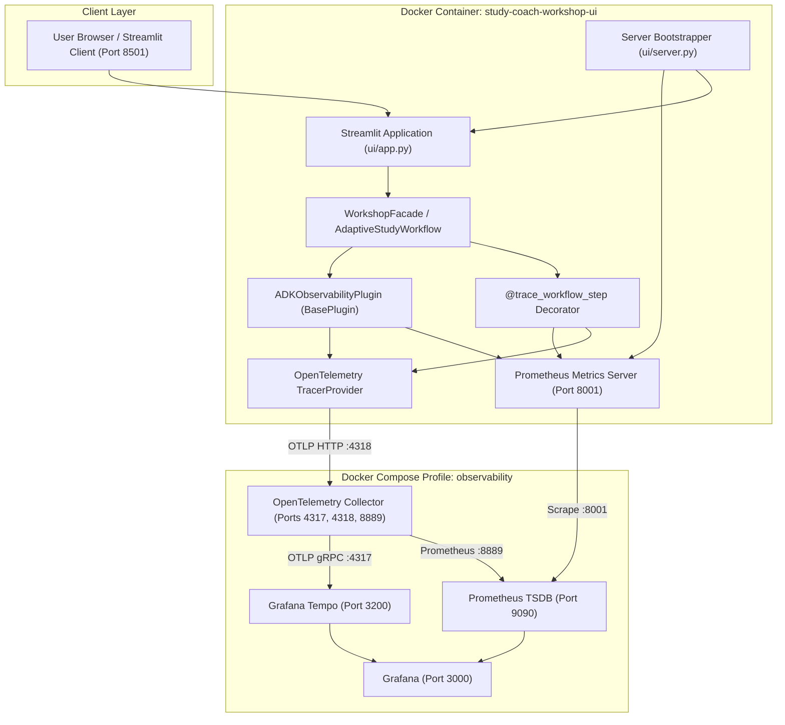

# Observability Guide — Gemini ADK Study Coach Lab

This guide covers the OpenTelemetry tracing, Prometheus metrics, Grafana Tempo distributed trace storage, and Grafana dashboard visualization configured for the **Gemini ADK Study Coach Lab**.

---

## 1. Observability Architecture



---

## 2. Core Components

### 2.1 ADKObservabilityPlugin (`study_coach.observability.instrumentation`)
An official Google ADK plugin implementing `google.adk.plugins.base_plugin.BasePlugin`:
- **`before_run_callback`**: Starts an OpenTelemetry agent span `adk.agent.<name>`, increments `study_coach_agent_calls_total{agent, model}`.
- **`after_run_callback`**: Sets status `OK` and ends agent span.
- **`on_run_error_callback`**: Records exception and increments `study_coach_agent_errors_total{agent, error_type}`.
- **`before_tool_callback`**: Starts tool span `adk.tool.<name>` and increments `study_coach_tool_calls_total{tool, status="invoked"}`.
- **`after_tool_callback`**: Marks tool span as `OK` and ends span.
- **`on_tool_error_callback`**: Records tool error and sets span status to `ERROR`.

### 2.2 `@trace_workflow_step` Decorator
Decorates high-level workflow boundaries (`WorkshopFacade.explain_topic`, `create_initial_plan`, `generate_practice_quiz`, `generate_quick_check`, `evaluate_quick_check`, `submit_quiz_answers`, `generate_adapted_plan`):
- Measures execution duration and records in `study_coach_request_duration_seconds{workflow, status}` histogram.
- Increments `study_coach_requests_total{workflow, status}` counter.
- Emits parent application spans linking lower-level ADK agent and tool executions.

### 2.3 Prometheus Metrics Registry (`study_coach.observability.metrics`)
Exposes application metrics on HTTP port 8001 using Prometheus format:
- `study_coach_requests_total`: Incoming user requests across all workflows.
- `study_coach_request_duration_seconds`: Workflow execution latency histogram.
- `study_coach_agent_calls_total`: Invocations by agent name and model.
- `study_coach_agent_errors_total`: Failures by agent name and error class.
- `study_coach_tool_calls_total`: Tool invocations by tool name and status.
- `study_coach_quiz_submissions_total`: Formative quick-checks and practice quizzes submitted.
- `study_coach_quiz_generation_duration_seconds`: Quiz generator latency.
- `study_coach_replanning_total`: Total adaptive replanning triggers.

**Startup Pre-Registration (`init_metrics`)**:
Metric labels are pre-instantiated on server startup, ensuring Prometheus scraping targets immediately observe active metric series with initial zero values rather than empty vector responses.

---

## 3. Privacy, Security & Data Sanitization

Telemetry is strictly sanitized before export to comply with enterprise safety:
1. **API Key Redaction**: `sanitize_value` scrubs any Gemini/Google Cloud keys (`AIzaSy...`) using pattern substitution `[REDACTED_API_KEY]`.
2. **Private Quiz Answer Keys**: Quiz generation and grading workflows separate student views (`to_student_view()`) from private answer keys. Spans never export correct option keys or confidential explanations before student submission.
3. **No Student PII**: Session identifiers are pseudorandom UUIDs (`sess_...`), and no personal student credentials or sensitive prompts are exported as span attributes.

---

## 4. Docker Compose Observability Profile

Observability services are isolated under the `observability` Docker Compose profile:

```bash
# Validate Compose configuration
docker compose --profile observability config

# Build and start all five services
docker compose --profile observability up -d --build

# Inspect running services
docker compose --profile observability ps
```

### Services Summary

| Service | Container Name | Port | Description |
|---|---|---|---|
| **Streamlit UI** | `study-coach-workshop-ui` | `8501`, `8001` | Web application + Prometheus metrics |
| **OTel Collector** | `study-coach-otel-collector` | `4317`, `4318`, `8889` | OpenTelemetry Collector receiver & exporter |
| **Grafana Tempo** | `study-coach-tempo` | `3200` | High-volume distributed tracing backend |
| **Prometheus** | `study-coach-prometheus` | `9090` | Time-series metrics scraper and storage |
| **Grafana** | `study-coach-grafana` | `3000` | Pre-provisioned dashboards and trace exploration |

---

## 5. Grafana Dashboard and Datasources

Grafana is pre-configured with auto-provisioned datasources and dashboards:
- **Datasources**:
  - `Prometheus`: `http://prometheus:9090` (default metric datasource)
  - `Tempo`: `http://tempo:3200` (trace search and span waterfall visualization)
- **Pre-provisioned Dashboard**:
  - Access at: `http://localhost:3000/d/study-coach-main/study-coach-workshop-observability`
  - Anonymous admin access enabled for seamless local lab evaluation.
  - 11 pre-built panels tracking request rates, agent calls, tool invocations, average latencies, quiz submissions, and adaptive replanning counts.
 
### 5.1 Visual Agent Ops UI (Streamlit Tab)
The Streamlit application includes an interactive **"🔭 Agent Ops"** tab ([`ui/components/agent_ops.py`](../ui/components/agent_ops.py)) that provides:
- Live Prometheus target reachability check (Port 9090).
- OpenTelemetry Collector & Tempo Tracing readiness metrics.
- Direct links with distinct portal cards:
  - **Open Grafana Dashboard**: Deep link to `http://localhost:3000/d/study-coach-main/...`
  - **Open Tempo Trace Explorer**: Deep link to `http://localhost:3000/explore`
  - **Open Prometheus Targets**: Direct link to `http://localhost:9090/targets`
- Clear warning banner when background observability containers are offline, with exact launch command instructions.

---

## 6. Verification and Health Checks

```bash
# Verify Prometheus metrics endpoint
curl -s http://localhost:8001/metrics | grep study_coach

# Check Prometheus target status
curl -s http://localhost:9090/api/v1/targets | python3 -m json.tool

# Check Tempo readiness
curl -i http://localhost:3200/ready

# Check Tempo traces search
curl -s "http://localhost:3200/api/search?limit=5" | python3 -m json.tool

# Check Grafana health
curl -s http://localhost:3000/api/health
```
