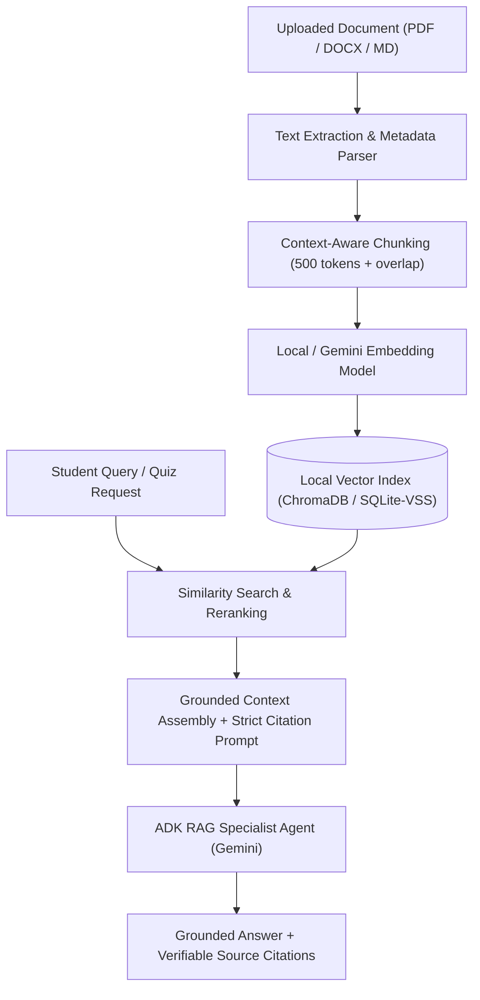

# Future Feature Roadmap (Post-v1.0.0)

> **Status**: Planned (Documentation Only)  
> **Target Release**: Post-v1.0.0 (Version TBD)  
> **Current Version**: v1.0.0 (Workshop-Ready Baseline)  
> **Notice**: Neither feature documented below is implemented in v1.0.0. Do not implement placeholder buttons or partial mock implementations until official milestone scheduling.

---

## Roadmap Overview

The Study Coach v1.0.0 release provides a complete, working multi-agent adaptive study coach anchored to the Google Cloud Generative AI Leader certification syllabus. The future roadmap expands the platform across subsequent feature iterations:

1. **PyPI Package & uvx CLI Distribution (Target: v1.1.0 / Issue #3)**: Making the Study Coach installable as a Python package (`gemini-adk-study-coach-lab`) with zero-clone startup (`uvx gemini-adk-study-coach-lab`), environment diagnostics (`doctor`), and bundled assets.
2. **Multi-Certification Management (Issue #1)**: Enabling custom tracks and self-directed curriculum creation across multiple cloud and software engineering certifications.
3. **Document RAG + Agent Chatbot + Guide-Grounded MCQs (Issue #2)**: Enabling students to upload proprietary PDF/DOCX study guides, ask grounded questions with source citations, and generate targeted practice questions from their personal documents.
4. **Persistent Student Progress (Issue #4)**: Local SQLite session persistence, resume functionality, and cross-session progress history.
5. **Agent Evaluation Regression Suite & CI (Issue #5)**: Automated deterministic agent regression cases and quality reporting.
6. **Workshop Launcher & Environment Diagnostics (Issue #6)**: Unified developer lab launcher coordinating with CLI diagnostics.

---

## Future Feature 1: Multi-Certification Management

### Objective
Allow learners to create, edit, import, and switch between multiple certification programs (e.g., Google Cloud Professional Cloud Architect, AWS Solutions Architect, Azure Fundamentals, CKA, or internal enterprise exams), maintaining complete data isolation between tracks.

### Architecture & Design Principles
- **No Unverified Syllabi**: Do not automatically scrape or hallucinate official exam syllabi. Syllabi are created via explicit user entry, JSON/YAML import, or verified administrative seed packages.
- **Strict Separation of Concerns**:
  - `CertificationTrack`: Immutable metadata defining the certification (code, title, provider, passing score).
  - `CurriculumTopic`: Normalized syllabus topics belonging to a certification track.
  - `CertificationEnrollment`: Student session state tracking exam deadlines, daily minute budgets, completed topics, weak areas, and quiz history.
  - A student's exam date and diagnostic scores belong to **enrollment state**, *never* the shared certification track definition.
- **Persistence Tier**: SQLite database with Pydantic validation models, replacing single-file YAML state while preserving backward compatibility with the existing Google Cloud Generative AI Leader curriculum.

### Proposed User Interface Flow

```text
Certifications Navigation:
  ├── [Select Active Certification] (Dropdown with enrollment stats)
  ├── [Add New Certification Track]
  │     ├── Step 1: Track Details (Title, Provider, Passing Score, Description)
  │     ├── Step 2: Curriculum Builder (Add Topics, Subtopics, Weights, Resources)
  │     ├── Step 3: Review & Schema Validation
  │     └── Step 4: Save to Local Registry
  └── [Manage Existing Track] (Edit topics, export JSON, delete custom track)
```

### Proposed Domain Models (Planned)

```python
# Planned future domain models (DO NOT IMPLEMENT IN v1.0.0)
class CertificationTrack(BaseModel):
    id: str  # e.g., "gcp_pca", "aws_saa_c03"
    title: str
    provider: str  # e.g., "Google Cloud", "AWS", "CNCF"
    description: str
    is_custom: bool = True
    passing_percentage: float = 70.0
    created_at: str


class CurriculumTopic(BaseModel):
    id: str
    certification_id: str
    title: str
    difficulty: Literal["beginner", "intermediate", "advanced"]
    estimated_minutes: int
    subtopics: list[str]


class CertificationEnrollment(BaseModel):
    enrollment_id: str
    student_id: str
    certification_id: str
    exam_date: str
    daily_budget_minutes: int
    completed_topic_ids: list[str]
    weak_topic_ids: list[str]
    plan_revision: int
```

### Recommended Implementation Phasing
1. **Phase 1A**: Data models and SQLite repository layer with schema migrations.
2. **Phase 1B**: Curriculum registry service ensuring backward compatibility with YAML assets.
3. **Phase 1C**: Streamlit GUI for creating, editing, and selecting certification tracks.
4. **Phase 1D**: Dynamic Study Planner and Quiz Generator integration scoped to active certification topics.
5. **Phase 1E**: Comprehensive test suite verifying cross-certification isolation and migration safety.

### Acceptance Criteria (For Future Development)
- Users can create, save, and reload custom certifications without restarting the server.
- The default Google Cloud Generative AI Leader certification continues functioning seamlessly.
- Generated study plans and quizzes only reference topics belonging to the selected certification.
- No quiz history, diagnostic scores, or time budgets leak across certifications.

---

## Future Feature 2: Document RAG + Agent Chatbot + Guide MCQs

### Objective
Allow learners to upload their own study guides, lecture notes, textbook chapters, or enterprise training materials (PDF, DOCX, TXT, Markdown), ask questions grounded directly in those materials, inspect precise page/source citations, and generate practice questions derived strictly from the uploaded content.

### Architecture & Design Principles
- **Local-First Privacy**: Document text extraction, chunking, and local vector indexing occur on the student's machine. Private documents are never uploaded to third-party vector databases.
- **Defense Against Prompt Injection**: User-uploaded document text is treated strictly as **untrusted data**, never as system prompts or tool instructions. Text chunks are passed to Gemini within delimited context windows with strict anti-jailbreak system instructions.
- **Missing-Evidence Abstention**: The model must explicitly state when an answer is not supported by the uploaded documents rather than hallucinating external knowledge.
- **Answer Key Security**: Generated MCQs must follow the existing Study Coach architecture: ground-truth answers and citations remain server-side until the student submits their attempt for deterministic grading.

### Proposed User Interface Flow

```text
Study Guides Tab:
  ├── [Upload Guide] (Drag & drop PDF / DOCX / Markdown)
  ├── [Document Library] (File list, chunk count, indexing status, deletion)
  └── [Indexing Inspector] (Chunk preview, word count, embedding health)

Ask Study Coach (RAG Chatbot):
  ├── [Chat Interface] (Ask questions across uploaded documents)
  ├── [Grounded Response] (Streaming answer with numbered citation badges)
  └── [Citation Inspector] (Side panel showing source document name, page #, exact excerpt)

Document-Grounded Practice Quiz:
  ├── [Select Document / Chapters]
  ├── [Choose Question Count] (3, 5, or 10 questions)
  ├── [Take Quiz] (Sanitized student view)
  └── [Deterministic Score & Source Review] (Score %, explanation + link to source excerpt)
```

### Proposed Processing Pipeline



### Dependencies
- **Feature 1 Dependency**: Document indexing must be scoped to specific `CertificationTrack` IDs to prevent cross-topic interference. Therefore, Feature 1 (Multi-Certification Management) must be implemented prior to Feature 2.

### Recommended Implementation Phasing
1. **Phase 2A**: Document extraction pipeline (PyPDF, python-docx, markdown parsers) with metadata preservation.
2. **Phase 2B**: Local chunking and embedding storage with certification-scoped isolation.
3. **Phase 2C**: Retrieval-augmented ADK agent with grounded system prompts and anti-injection defenses.
4. **Phase 2D**: Streamlit Chat GUI with expandable citation excerpts.
5. **Phase 2E**: Document-derived quiz generator with deterministic grading and source-page attribution.
6. **Phase 2F**: Evaluation suite verifying citation accuracy and abstention rate on out-of-domain queries.

### Acceptance Criteria (For Future Development)
- Text cleanly extracts from standard PDF and DOCX files without memory leaks.
- Grounded answers include verifiable source document names and page numbers.
- When query information is absent from documents, the agent cleanly abstains.
- Generated practice MCQs are graded deterministically with answer keys masked before submission.
- Telemetry captures retrieval latency, chunk count, and embedding token costs without logging private document contents.
